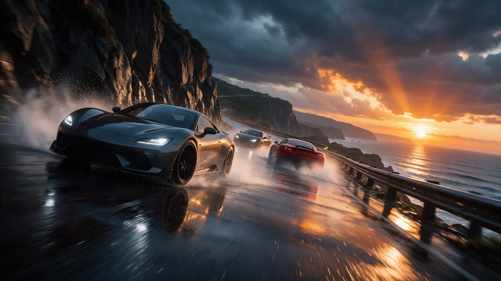

# 3D Racing

Arcade racing with drift, gears and rivals: pick a car in the garage, pick a track, and race a wet coastal mountain road.

A full vertical slice, from boot screen to results, with a track-authoring toolkit so you can build your own routes.

## What's inside

- Storm Coast: a coastal mountain route with wet-road lighting, ocean haze and fast, readable corners.
- A 3D garage showroom to pick your car (Vanta R49 or Astra R50) and paint, with Easy, Medium and Hard rivals.
- Drift, plus automatic or manual gear shifting.
- Full race flow: loading, countdown, in-race menu and results.
- A profile-driven track pipeline and authoring toolkit (road points, width, banking, elevation, zones, start grid, generated props).
- Per-track music, engine, drift and brake audio, and a locked-track example (Showcase Circuit) ready for progression.

## Get started

1. [Download the ZIP](https://github.com/SummerEngine/template-3d-racing-game/archive/refs/heads/main.zip) or clone the repo:
   `git clone https://github.com/SummerEngine/template-3d-racing-game.git`
2. Open the folder in [Summer Engine](https://www.summerengine.com/download).
3. Press Play, choose a car and a track, and hit race.

Summer's AI agent can extend it for you. Try asking:

- "Unlock Showcase Circuit after the player wins a race on Storm Coast."
- "Add a nitro boost that fills up while drifting."
- "Add a time trial mode with a ghost car of the best lap."

## Controls

| Action | Keyboard |
|---|---|
| Accelerate | W or Up |
| Brake / reverse | S or Down |
| Steer | A / D or Left / Right |
| Drift | Shift |
| Shift down / up (manual) | Q / E |
| Change camera | C |
| Look back | V |
| Race menu | Tab |

## Building on it

- Tracks are data. `scripts/game/game_session.gd` holds `TRACK_OPTIONS`; a new track is a race scene plus one entry there.
- Cars, paints, difficulty tiers and transmission options are tables in the same file.
- The menu UI is built in code in `scripts/ui/main_menu.gd`; `scenes/ui/garage_showroom.tscn` is its 3D backdrop.
- Build new routes with the authoring toolkit in `scripts/track_authoring/` and `scenes/tracks/`.
- Car physics live in `scripts/vehicles/`; race flow in `scripts/race/`.

## License

MIT. See [LICENSE](LICENSE).
